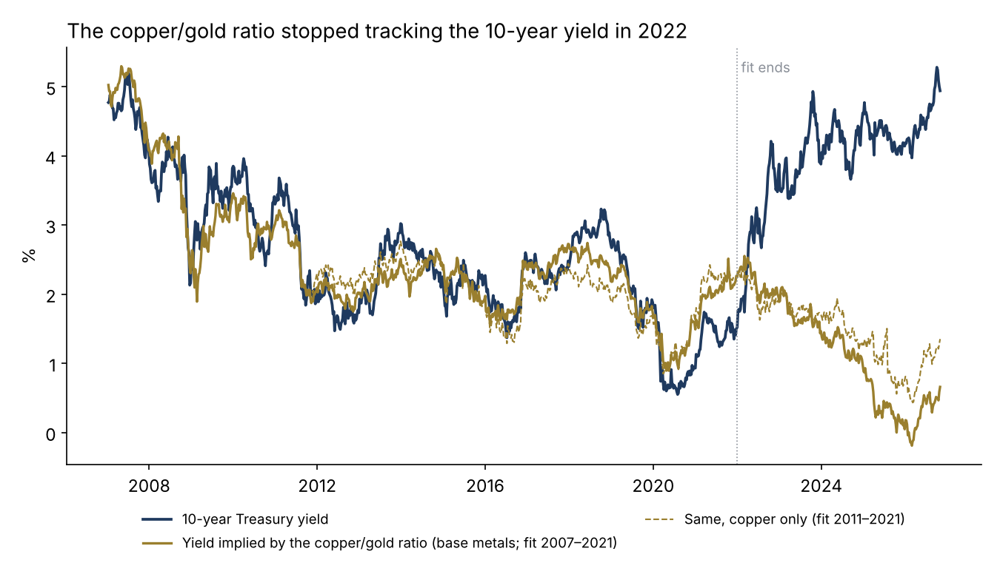
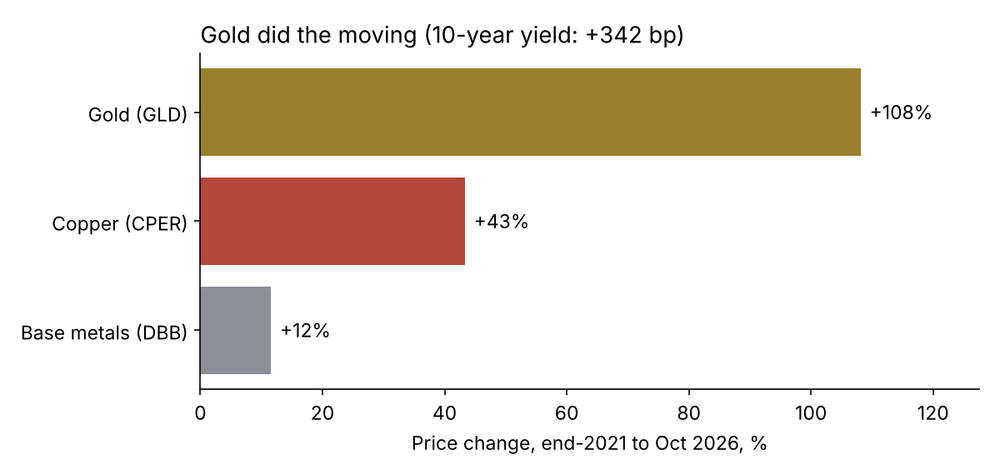
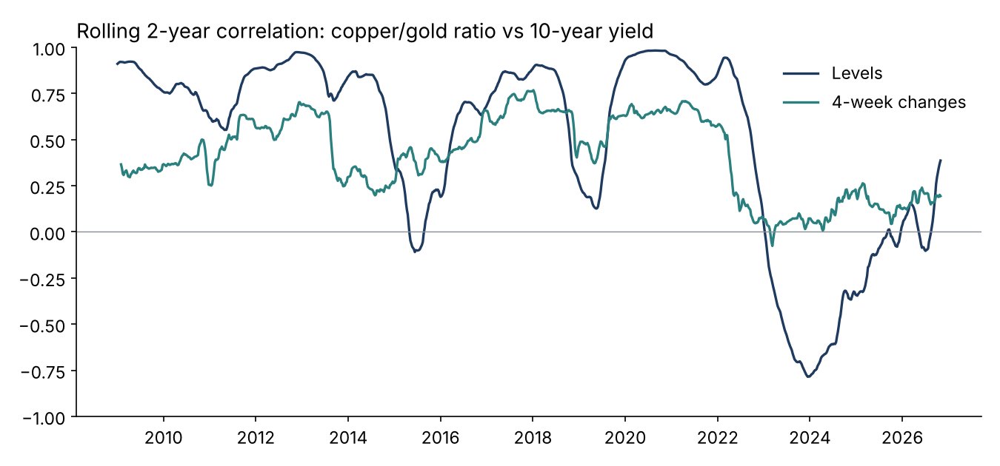
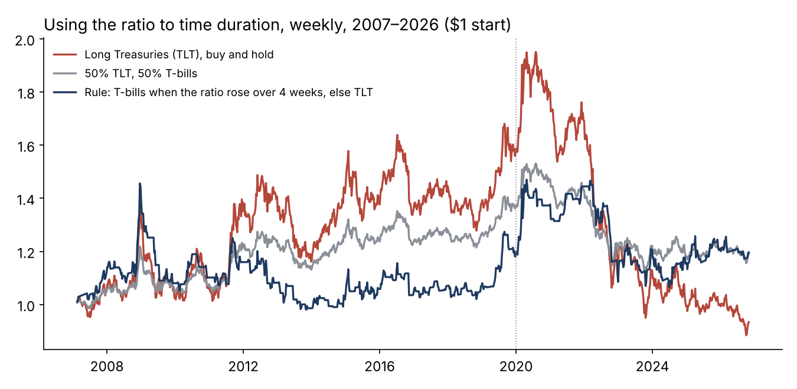

# Is the copper/gold ratio still a yield signal? Base metals, gold and the 10-year Treasury, 2007–2026

 

**Question.** The copper/gold ratio is widely quoted as a signal for where the 10-year Treasury yield "should" be. Does it still track yields, does it predict them out of sample, and can it time duration?

**Answer, on real data.** Weekly, January 2007 to October 2026 (1,034 weeks). Main test: base-metals fund DBB / gold fund GLD; check: copper-only fund CPER / GLD from November 2011.

- **It tracked, then broke.** Correlation with the 10-year yield: 0.93 (2007–13), 0.85 (2014–21), −0.67 (2022–26); copper-only 0.84, 0.69, −0.59. Rolling two-year correlation bottomed at −0.78 in January 2024 and is about 0.4 now.
- **The fair value is 4 points off.** A line fitted on 2007–2021 implies a 10-year yield of 0.7% today (copper-only: 1.4%), against 4.94% actual. At the end of 2021 the gap was −0.7 points.
- **Gold did the moving.** End-2021 to October 2026: gold +108%, copper +43%, base metals +12%, 10-year yield +342 bp.
- **It never predicted.** Four-week forecasts of yield changes, expanding window, out of sample: R² −3.4% vs no change (205 forecasts from 2011), copper −1.6% (142 from 2015); hit rates 46% and 52%.
- **The weekly link faded.** A 10% rise in the ratio went with +16 bp in yields before 2022 (correlation 0.47) and +5 bp since (0.09).
- **Duration rule fails one half.** T-bills when the ratio rose over four weeks, else TLT. 2007–19: Sharpe 0.18 vs 0.32 TLT vs 0.38 for 50/50. 2020–26: 0.07 vs −0.43 vs −0.23.

Full write-up: https://www.guptagaurav.info/articles/is-the-copper-gold-ratio-still-a-yield-signal






## Method

- **Ratio.** log(DBB / GLD) weekly (Friday close); CPER / GLD as a check.
- **Fair value.** OLS of the 10-year par yield (%) on the ratio, 2007–2021 only (pre-registered), applied to all dates.
- **Co-movement.** Non-overlapping four-week changes; yield change (bp) per 10% ratio change.
- **Forecasts.** Next four-week yield change on the past four-week ratio change; expanding OLS with at least 52 observations; OOS R² against a no-change forecast (Campbell & Thompson 2008).
- **Duration rule.** Signal known at the prior close; T-bill return from the 3-month par yield; split at end-2019 (pre-registered).

## The commercial case

| Element | What it is |
|---|---|
| Who pays | Rates and macro desks, multi-asset and OCIO teams, strategists who publish cross-asset fair values |
| The problem in dollars | A 10-year position on $1bn moves ≈ $85m per 100 bp; the ratio's fair value is ≈ 4 points off (illustrative) |
| The product | A Signal Regime Monitor: rolling correlation, out-of-sample scores and break alerts per cross-asset indicator |
| Proof | 19 years, two metal measures, pre-registered fit window and split |
| Build vs buy | 2–3 weeks per indicator set; today desks read charts by eye |
| Pricing logic | $20–40k per indicator set; $75k a year as a monitor (illustrative) |
| KPI | Lead time between a break alert and the desk dropping the signal |

## Data and citations

Data
- DBB, CPER, GLD, TLT prices and US Treasury par yields: [huggingface.co/datasets/defeatbeta/yahoo-finance-data](https://huggingface.co/datasets/defeatbeta/yahoo-finance-data) (ODC-BY), files `stock_prices`, `daily_treasury_yield`, pinned by sha256 in `configs/default.yaml`.

Methods
- Campbell, J. Y. and Thompson, S. B. (2008). "Predicting Excess Stock Returns Out of Sample: Can Anything Beat the Historical Average?" *Review of Financial Studies* 21(4), 1509–1531.
- Welch, I. and Goyal, A. (2008). "A Comprehensive Look at the Empirical Performance of Equity Premium Prediction." *Review of Financial Studies* 21(4), 1455–1508.

Code, analysis, charts and text were produced with AI assistance (Claude, by Anthropic) and reviewed by Gaurav Gupta.

## Run it

```bash
pip install -r requirements.txt
make all
make test
```

*Independent research on public data. Fund prices stand in for metals. Not investment advice. Dollar figures are illustrative.*
